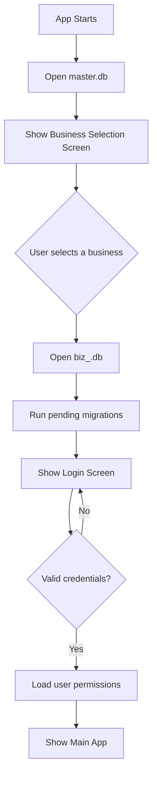
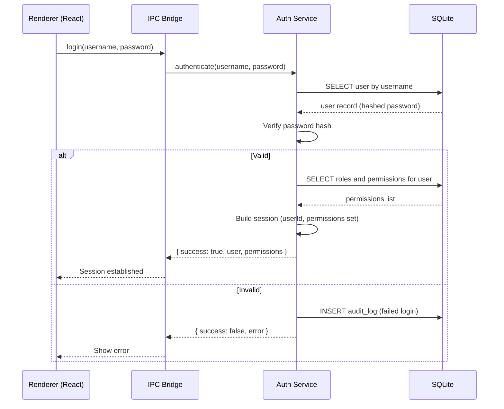
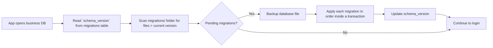
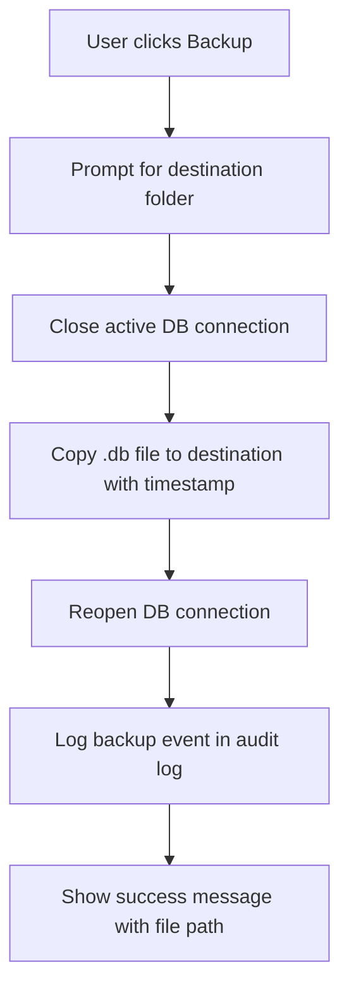
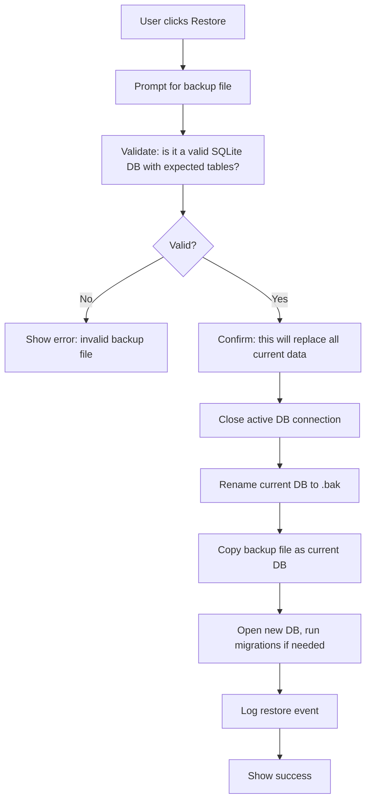
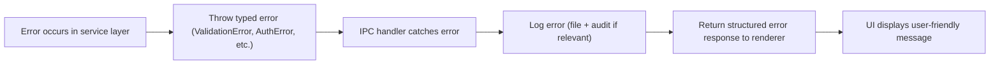
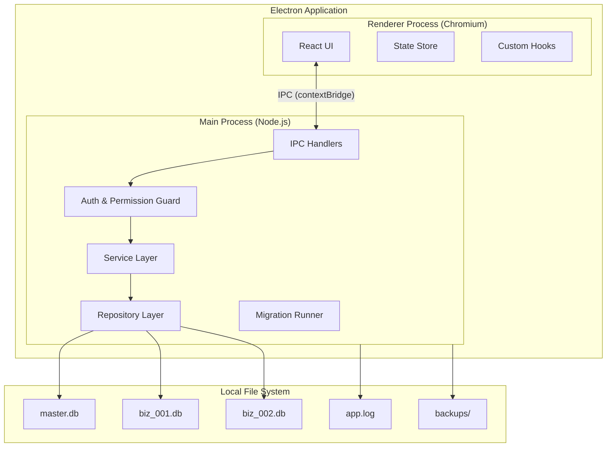
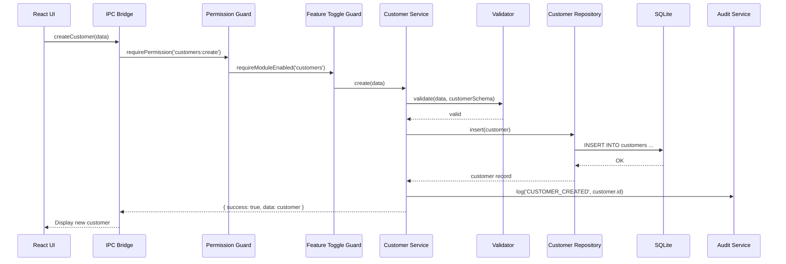

# Architecture Document

## Vehicle Service Center Management & Business Intelligence System

| Field            | Value                          |
| ---------------- | ------------------------------ |
| Version          | 0.1 – Draft                    |
| Status           | Awaiting Product Owner Review  |
| Last Updated     | 2026-11-13                     |

---

## 1. Technology Stack

### 1.1 Electron

| Aspect      | Detail |
|-------------|--------|
| **What**    | A framework that packages web applications as native desktop apps using Chromium and Node.js. |
| **Used for**| The application shell — window management, file system access, native menus, system tray, auto-update, printing. |
| **Why needed** | Enables a cross-platform desktop app built with web technologies while providing full access to the local file system and OS APIs (required for SQLite, backup, printing). |
| **How it works here** | Electron runs two processes: the **main process** (Node.js — handles database, file I/O, business logic) and the **renderer process** (Chromium — runs the React UI). They communicate via IPC (Inter-Process Communication). All security-sensitive operations (DB queries, permission checks, file access) run in the main process. The renderer never directly accesses the database. |
| **Essential for v1?** | **Yes** — it is the application runtime. |

### 1.2 React

| Aspect      | Detail |
|-------------|--------|
| **What**    | A JavaScript library for building component-based user interfaces. |
| **Used for**| All UI screens: login, dashboard, forms, tables, modals, settings. |
| **Why needed** | Component model maps well to the module structure (each module = a set of components). Large ecosystem for UI elements (tables, charts, date pickers). |
| **How it works here** | React runs in the Electron renderer process. It calls the main process via IPC for all data operations. React never imports database libraries directly. State management is handled with React Context or a lightweight store (e.g., Zustand). |
| **Essential for v1?** | **Yes** — it is the UI layer. |

### 1.3 TypeScript

| Aspect      | Detail |
|-------------|--------|
| **What**    | A typed superset of JavaScript that compiles to plain JavaScript. |
| **Used for**| All application code — both main process and renderer. |
| **Why needed** | Type safety catches bugs at compile time, especially important for money calculations (integer-only), permission enums, and complex data structures. Self-documenting code. |
| **How it works here** | All source files are `.ts` or `.tsx`. Shared types (e.g., `MoneyAmount`, `Permission`, `Role`) are defined once and used across both processes. |
| **Essential for v1?** | **Yes** — foundational for correctness. |

### 1.4 SQLite (via better-sqlite3)

| Aspect      | Detail |
|-------------|--------|
| **What**    | An embedded relational database engine. `better-sqlite3` is a synchronous Node.js binding. |
| **Used for**| All persistent data storage — one database file per business, plus a small master registry database. |
| **Why needed** | Local-first, zero-configuration, single-file database. No database server to install. File-based storage makes backup trivial (copy the file). Synchronous API avoids callback complexity for transactional operations. |
| **How it works here** | The main process opens one SQLite connection at a time (the selected business's database). WAL mode is enabled for crash resilience. Foreign keys are enforced. All writes use transactions. Migrations are versioned SQL files applied on startup. |
| **Essential for v1?** | **Yes** — it is the data layer. |

### 1.5 Versioned Database Migrations

| Aspect      | Detail |
|-------------|--------|
| **What**    | A system where each database schema change is a numbered SQL file (e.g., `001_initial.sql`, `002_add_quotations.sql`). |
| **Used for**| Creating tables, adding columns, changing indexes — all schema evolution. |
| **Why needed** | Ensures every business database is at the correct schema version. Makes updates safe and repeatable. |
| **How it works here** | A `migrations` table tracks which migrations have been applied. On app startup (after business selection), the migration runner checks the current version and applies any pending migrations in order. Migrations are forward-only (no down migrations in v1). A backup is taken before migration. |
| **Essential for v1?** | **Yes** — required from the first table creation onward. |

### 1.6 Additional Libraries (Selected in Implementation)

| Library            | Purpose                        | Essential for v1? |
|--------------------|--------------------------------|-------------------|
| argon2 or bcrypt   | Password hashing               | Yes               |
| Zod or Yup         | Input validation schemas       | Yes (one of them) |
| Zustand or Context | React state management         | Yes (one of them) |
| TanStack Table     | Data tables with sorting/filtering | Yes            |
| Recharts or Chart.js | BI dashboard charts          | Phase 7           |
| i18next            | Internationalization           | ASSUMPTION — depends on Open Question 3 |
| electron-builder   | Packaging and installer        | Phase 8           |

---

## 2. Project Folder Structure

```
bi/
├── docs/                          # All documentation (SRS, architecture, DB, rules, phases)
├── src/
│   ├── main/                      # Electron main process (Node.js)
│   │   ├── index.ts               # App entry point, window creation
│   │   ├── ipc/                   # IPC handler registrations
│   │   │   ├── auth.ipc.ts
│   │   │   ├── customers.ipc.ts
│   │   │   ├── ...                # One file per module
│   │   ├── database/
│   │   │   ├── connection.ts      # DB open/close, WAL mode, pragmas
│   │   │   ├── master.ts          # Master registry DB operations
│   │   │   ├── migrate.ts         # Migration runner
│   │   │   └── migrations/        # Numbered SQL migration files
│   │   │       ├── 001_initial_schema.sql
│   │   │       ├── 002_...sql
│   │   │       └── ...
│   │   ├── services/              # Business logic (one file per module)
│   │   │   ├── auth.service.ts
│   │   │   ├── customers.service.ts
│   │   │   ├── permissions.service.ts
│   │   │   ├── settings.service.ts
│   │   │   ├── audit.service.ts
│   │   │   ├── ...
│   │   ├── repositories/          # Data access layer (SQL queries)
│   │   │   ├── users.repo.ts
│   │   │   ├── customers.repo.ts
│   │   │   ├── ...
│   │   └── utils/                 # Shared utilities (money, dates, validation)
│   │       ├── money.ts
│   │       ├── dates.ts
│   │       └── ...
│   ├── renderer/                  # Electron renderer process (React)
│   │   ├── index.html
│   │   ├── main.tsx               # React entry point
│   │   ├── App.tsx                # Root component, routing
│   │   ├── components/            # Shared UI components
│   │   │   ├── Layout/
│   │   │   ├── Table/
│   │   │   ├── Form/
│   │   │   └── ...
│   │   ├── modules/               # Feature modules (one folder per module)
│   │   │   ├── auth/
│   │   │   │   ├── LoginPage.tsx
│   │   │   │   ├── BusinessSelect.tsx
│   │   │   │   └── ...
│   │   │   ├── dashboard/
│   │   │   ├── customers/
│   │   │   ├── vehicles/
│   │   │   ├── settings/
│   │   │   └── ...
│   │   ├── hooks/                 # Custom React hooks
│   │   ├── store/                 # State management
│   │   └── styles/                # Global styles, theme
│   ├── shared/                    # Types and constants shared across processes
│   │   ├── types/
│   │   │   ├── customer.types.ts
│   │   │   ├── invoice.types.ts
│   │   │   ├── permission.types.ts
│   │   │   ├── money.types.ts
│   │   │   └── ...
│   │   ├── constants/
│   │   │   ├── permissions.ts     # Permission key enum
│   │   │   ├── defaults.ts        # Default settings, roles
│   │   │   └── ...
│   │   └── validation/            # Zod/Yup schemas shared by both processes
│   │       ├── customer.schema.ts
│   │       └── ...
├── tests/
│   ├── unit/                      # Unit tests (services, utils, money)
│   ├── integration/               # Integration tests (DB operations)
│   └── e2e/                       # End-to-end tests (Electron app)
├── resources/                     # Static assets (icons, default logo)
├── scripts/                       # Build and utility scripts
├── package.json
├── tsconfig.json
├── electron-builder.yml           # Installer configuration
└── README.md
```

### Key Principles

- **Main process owns all data and logic.** The renderer is a "dumb" UI.
- **One IPC file per module** keeps the IPC surface organized.
- **Services contain business logic.** Repositories contain SQL.
- **Shared types** prevent drift between processes.
- **Validation schemas** are shared so both the UI and the backend validate identically.

---

## 3. Business Database Isolation

### 3.1 Master Registry

A small SQLite database (`master.db`) in the application data directory stores only:

```
businesses table:
  id          TEXT PRIMARY KEY    -- UUID
  name        TEXT NOT NULL       -- Display name
  db_filename TEXT NOT NULL       -- Filename of the business database
  created_at  TEXT NOT NULL       -- ISO 8601
  is_active   INTEGER DEFAULT 1  -- Soft delete
```

This database contains no business data — only the list of businesses and their database file paths.

### 3.2 Business Database Files

Each business gets its own SQLite file stored in a dedicated directory:

```
<app-data>/databases/
  ├── master.db
  ├── biz_<uuid1>.db
  ├── biz_<uuid2>.db
  └── ...
```

### 3.3 Database Lifecycle



### 3.4 Isolation Guarantees

1. **Only one business database is open at a time.** There is no mechanism to query across databases.
2. **The renderer process never knows the database path.** It communicates via IPC using logical identifiers.
3. **Switching businesses** requires logging out, which closes the current database connection before opening another.
4. **The master registry** contains no business data — only names and filenames.

### 3.5 Future Multi-Computer Support

If Open Question 1 results in multi-computer use, the architecture supports migration because:
- All data access goes through the service layer (not direct DB calls from the UI).
- The service layer can be replaced with a local HTTP API server with minimal changes.
- The database layer is already isolated behind repositories.

---

## 4. Authentication & Authorization

### 4.1 Authentication Flow



### 4.2 Session Management

- The session is an in-memory object in the main process. It holds: `userId`, `username`, `roleIds`, and a `Set<PermissionKey>`.
- The session is created on successful login and destroyed on logout or app close.
- No tokens or cookies — this is a local desktop app, not a web server.

### 4.3 Permission Check (Backend Enforcement)

Every IPC handler that performs a data operation checks permissions before executing:

```
function requirePermission(permissionKey: string): void {
    if (!currentSession) throw new AuthError('Not authenticated');
    if (!currentSession.permissions.has(permissionKey)) {
        auditLog('PERMISSION_DENIED', permissionKey);
        throw new ForbiddenError(`Missing permission: ${permissionKey}`);
    }
}
```

**This check runs in the main process, not in the renderer.** The UI may also hide buttons for UX, but the backend is the authority.

### 4.4 Permission Keys

Permissions are granular strings following a `module:action` pattern:

```
customers:view       customers:create      customers:edit        customers:delete
vehicles:view        vehicles:create       vehicles:edit         vehicles:delete
jobcards:view        jobcards:create       jobcards:edit         jobcards:assign
jobcards:update_progress
invoices:view        invoices:create       invoices:void
payments:view        payments:create
inventory:view       inventory:create      inventory:edit        inventory:adjust
purchases:view       purchases:create
quotations:view      quotations:create     quotations:approve
settings:view        settings:edit
settings:users       settings:roles        settings:permissions
reports:view         reports:export
finance:view         finance:create_expense
bi:view
audit:view
backup:create        backup:restore
```

> The exact list will grow as modules are built. Each module defines its permissions when implemented.

### 4.5 Owner Role Protection

The "Business Owner/Admin" role has a system flag `is_owner = true`. Logic:
1. This role always includes `settings:*` permissions.
2. The permission matrix UI prevents removing settings permissions from this role.
3. At least one user must always be assigned the owner role.
4. These constraints are enforced in the service layer, not just the UI.

### 4.6 Feature Toggle Integration

When a module is toggled off:
1. Its routes are not rendered (UI-level).
2. Its IPC handlers reject calls with a "module disabled" error (backend-level).
3. Its permissions are grayed out in the permission matrix (UX).
4. Its data remains intact in the database.

---

## 5. Settings & Feature Toggles

### 5.1 Settings Storage

Settings are stored in a `settings` table within each business database:

```
settings table:
  id          TEXT PRIMARY KEY    -- UUID
  category    TEXT NOT NULL       -- e.g., 'business_profile', 'financial', 'workflow'
  key         TEXT NOT NULL       -- e.g., 'tax_rate', 'currency_code'
  value       TEXT NOT NULL       -- JSON-encoded value
  value_type  TEXT NOT NULL       -- 'string' | 'number' | 'boolean' | 'json'
  updated_by  TEXT                -- FK to users
  updated_at  TEXT                -- ISO 8601
  UNIQUE(category, key)
```

### 5.2 Default Settings

On business creation, the migration seeds all required settings with default values. The application code defines a `DEFAULT_SETTINGS` map. When reading a setting, the service layer:

1. Queries the `settings` table.
2. If not found, returns the default from the code.
3. Casts the value according to `value_type`.

This means the database only stores settings that have been explicitly changed, plus the initial seed.

### 5.3 Feature Toggles

Feature toggles are a special category of settings:

```
category: 'feature_toggles'
key: 'module_appointments'   value: 'true'   value_type: 'boolean'
key: 'module_quotations'     value: 'true'   value_type: 'boolean'
key: 'module_inventory'      value: 'true'   value_type: 'boolean'
key: 'module_finance'        value: 'true'   value_type: 'boolean'
key: 'module_bi'             value: 'true'   value_type: 'boolean'
```

**Toggle enforcement is dual-layer:**

1. **Renderer:** A `useFeatureToggle('module_name')` hook controls route rendering and menu visibility.
2. **Main process:** A `requireModuleEnabled('module_name')` guard in IPC handlers blocks operations for disabled modules.

### 5.4 Audit Trail for Settings

Every settings change is logged:

```
audit_log entry:
  action: 'SETTING_CHANGED'
  entity_type: 'setting'
  entity_id: setting.id
  old_value: previous JSON value
  new_value: new JSON value
  user_id: who made the change
```

---

## 6. Migration & Update Strategy

### 6.1 Schema Migrations



**Migration file format:**

```
migrations/
  001_initial_schema.sql      -- Phase 1 tables
  002_customers_vehicles.sql  -- Phase 2 tables
  003_catalogue_inventory.sql -- Phase 3 tables
  ...
```

Each file is a pure SQL script. The migration runner:
1. Wraps each file in a transaction.
2. Records the version number and timestamp in a `migrations` table.
3. Is idempotent — it checks which migrations have already run.

### 6.2 Application Updates

In v1, updates are delivered via a new installer (manual download and install). The process:
1. User downloads a new version.
2. Installs over the existing installation.
3. On next launch, the migration runner brings each business database up to date.

**Later (post-v1):** electron-builder's auto-update can be added for over-the-air updates.

### 6.3 Migration Safety Rules

1. **Never delete a column in a migration.** Add new columns; deprecate old ones.
2. **Never rename a column directly.** Add new column, migrate data, deprecate old column.
3. **Always provide default values** for new NOT NULL columns.
4. **Always backup before migrating** (handled automatically by the migration runner).
5. **Migrations are forward-only.** No rollback scripts in v1. If a migration fails, restore from backup.

---

## 7. Backup & Restore Design

### 7.1 What is Backed Up

A backup is a copy of the entire business database file (`.db`). Since all business data — including settings, audit logs, and user accounts — lives in one file, this is a complete backup.

### 7.2 Backup Process



**Backup filename format:** `<business_name>_<YYYY-MM-DD_HH-mm-ss>.db`

### 7.3 Restore Process



### 7.4 Backup Destination

**OPEN QUESTION 5:** Backup to USB, local folder, or cloud? Until answered, the implementation supports selecting any local folder (which could be a USB drive or a local directory).

---

## 8. Error Handling & Logging

### 8.1 Error Categories

| Category        | Example                              | Handling                                   |
|-----------------|--------------------------------------|--------------------------------------------|
| Validation      | Invalid phone number                 | Return structured error to UI; show inline. |
| Auth            | Wrong password, no permission        | Return error; log to audit log.            |
| Data Integrity  | Stock below zero, orphan reference   | Block operation; return error.             |
| Database        | SQLite constraint violation          | Roll back transaction; log; show user-friendly message. |
| System          | File system error, out of disk space | Log; show error dialog; do not crash.      |
| Unexpected      | Uncaught exception                   | Log full stack trace; show generic error; do not crash. |

### 8.2 Error Flow



### 8.3 Logging

**Application log:** A local log file (`app.log`) in the application data directory. Uses a simple logger with levels: `ERROR`, `WARN`, `INFO`, `DEBUG`.

- **Production:** `INFO` and above.
- **Development:** `DEBUG` and above.
- Log rotation: new file per day or when file exceeds 10 MB. Keep last 30 days. **[SUGGESTED]**

**Audit log:** Separate from the application log. Stored in the business database (see DATABASE.md). Records business-significant events, not technical debugging info.

### 8.4 Crash Recovery

- SQLite WAL mode ensures the database is not corrupted by an app crash.
- On startup, SQLite automatically recovers from WAL if the previous session crashed.
- The migration runner detects incomplete migrations (no version bump) and warns the user.

---

## 9. Architecture Diagrams

### 9.1 High-Level Architecture



### 9.2 Request Flow (Example: Create Customer)



---

## 10. Security Considerations

### 10.1 Electron Security Best Practices

1. **Context isolation enabled** — the renderer cannot access Node.js APIs directly.
2. **Node integration disabled** in the renderer.
3. **Preload script** exposes only specific IPC channels via `contextBridge`.
4. **No `eval()` or `new Function()`** in the renderer.
5. **Content Security Policy** restricts inline scripts and external resources.
6. **No remote content** loaded — the app is entirely local.

### 10.2 Database Security

- Database files are stored in the OS user's application data directory with standard file permissions.
- In v1, database files are not encrypted. **[ASSUMPTION]** — SQLCipher can be added later if needed.
- Passwords are hashed (argon2 or bcrypt) — never stored in plaintext.

### 10.3 IPC Security

- Each IPC channel is mapped to a specific service operation.
- All IPC handlers validate input before processing.
- The preload script exposes a whitelist of channels — no wildcard access.
