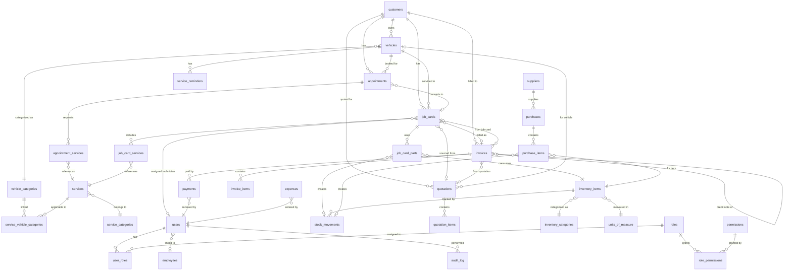
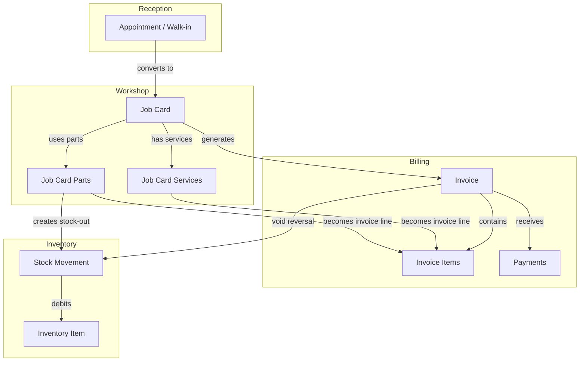

# Database Design Document

## Vehicle Service Center Management & Business Intelligence System

| Field            | Value                          |
| ---------------- | ------------------------------ |
| Version          | 0.1 – Draft                    |
| Status           | Awaiting Product Owner Review  |
| Last Updated     | 2026-11-13                     |

---

## 1. Database Strategy

### 1.1 Overview

- **One master registry database** (`master.db`) — stores only the list of businesses.
- **One SQLite database file per business** — contains all tables for that business.
- All tables below (except §2 Master Registry) exist in each business database.

### 1.2 Conventions

| Convention           | Rule                                                                                      |
| -------------------- | ----------------------------------------------------------------------------------------- |
| Primary keys         | `id TEXT PRIMARY KEY` — UUID v4, generated in the application layer.                      |
| Money                | `INTEGER` in smallest currency unit. Column name suffixed with `_amount` (e.g., `total_amount`). |
| Dates/times          | `TEXT` in ISO 8601 format (`YYYY-MM-DDTHH:mm:ss.sssZ`). Column name suffixed with `_at`. |
| Dates only           | `TEXT` in `YYYY-MM-DD` format. Column name suffixed with `_date`.                         |
| Booleans             | `INTEGER` (0 = false, 1 = true). SQLite has no native boolean type.                      |
| Soft delete          | `is_active INTEGER NOT NULL DEFAULT 1`. Queries filter `WHERE is_active = 1` by default.  |
| Foreign keys         | Always declared with `REFERENCES table(id)`. `PRAGMA foreign_keys = ON` enforced.         |
| Indexes              | On all foreign keys, and on columns used in search or filtering.                          |
| Timestamps           | Every table has `created_at TEXT NOT NULL` and `updated_at TEXT NOT NULL`.                 |
| Text encoding        | UTF-8 everywhere.                                                                         |

---

## 2. Master Registry Database (`master.db`)

### businesses

| Column       | Type    | Constraints                    | Description                       |
| ------------ | ------- | ------------------------------ | --------------------------------- |
| id           | TEXT    | PRIMARY KEY                    | UUID                              |
| name         | TEXT    | NOT NULL                       | Display name                      |
| db_filename  | TEXT    | NOT NULL UNIQUE                | Filename of the business DB       |
| created_at   | TEXT    | NOT NULL                       | ISO 8601                          |
| is_active    | INTEGER | NOT NULL DEFAULT 1             | Soft delete                       |

### migrations (in master.db)

| Column       | Type    | Constraints                    | Description                       |
| ------------ | ------- | ------------------------------ | --------------------------------- |
| version      | INTEGER | PRIMARY KEY                    | Migration sequence number         |
| name         | TEXT    | NOT NULL                       | Migration filename                |
| applied_at   | TEXT    | NOT NULL                       | ISO 8601                          |

---

## 3. Business Database — Full Table List

### 3.1 Authentication & Authorization

#### users

| Column          | Type    | Constraints                    | Description                           |
| --------------- | ------- | ------------------------------ | ------------------------------------- |
| id              | TEXT    | PRIMARY KEY                    | UUID                                  |
| username        | TEXT    | NOT NULL UNIQUE                | Login username                        |
| password_hash   | TEXT    | NOT NULL                       | argon2/bcrypt hash                    |
| display_name    | TEXT    | NOT NULL                       | Full name for display                 |
| email           | TEXT    |                                | Optional email                        |
| phone           | TEXT    |                                | Optional phone                        |
| is_active       | INTEGER | NOT NULL DEFAULT 1             | Soft delete                           |
| must_change_pwd | INTEGER | NOT NULL DEFAULT 0             | Force password change on next login   |
| last_login_at   | TEXT    |                                | ISO 8601                              |
| created_at      | TEXT    | NOT NULL                       | ISO 8601                              |
| updated_at      | TEXT    | NOT NULL                       | ISO 8601                              |

#### permissions

| Column          | Type    | Constraints                    | Description                           |
| --------------- | ------- | ------------------------------ | ------------------------------------- |
| id              | TEXT    | PRIMARY KEY                    | UUID                                  |
| key             | TEXT    | NOT NULL UNIQUE                | e.g., `customers:create`             |
| module          | TEXT    | NOT NULL                       | e.g., `customers`                    |
| description     | TEXT    |                                | Human-readable description            |
| created_at      | TEXT    | NOT NULL                       | ISO 8601                              |

#### roles

| Column          | Type    | Constraints                    | Description                           |
| --------------- | ------- | ------------------------------ | ------------------------------------- |
| id              | TEXT    | PRIMARY KEY                    | UUID                                  |
| name            | TEXT    | NOT NULL UNIQUE                | e.g., `Service Manager`             |
| description     | TEXT    |                                | Role description                      |
| is_system       | INTEGER | NOT NULL DEFAULT 0             | 1 = default role, cannot be deleted   |
| is_owner        | INTEGER | NOT NULL DEFAULT 0             | 1 = owner role; always has settings   |
| is_active       | INTEGER | NOT NULL DEFAULT 1             | Soft delete                           |
| created_at      | TEXT    | NOT NULL                       | ISO 8601                              |
| updated_at      | TEXT    | NOT NULL                       | ISO 8601                              |

#### role_permissions

| Column          | Type    | Constraints                                      | Description         |
| --------------- | ------- | ------------------------------------------------ | ------------------- |
| role_id         | TEXT    | NOT NULL REFERENCES roles(id)                    | FK to roles         |
| permission_id   | TEXT    | NOT NULL REFERENCES permissions(id)              | FK to permissions   |
| PRIMARY KEY     |         | (role_id, permission_id)                         | Composite PK        |

#### user_roles

| Column          | Type    | Constraints                                      | Description         |
| --------------- | ------- | ------------------------------------------------ | ------------------- |
| user_id         | TEXT    | NOT NULL REFERENCES users(id)                    | FK to users         |
| role_id         | TEXT    | NOT NULL REFERENCES roles(id)                    | FK to roles         |
| assigned_at     | TEXT    | NOT NULL                                          | ISO 8601            |
| assigned_by     | TEXT    | REFERENCES users(id)                             | Who assigned it     |
| PRIMARY KEY     |         | (user_id, role_id)                               | Composite PK        |

### 3.2 Settings & Feature Toggles

#### settings

| Column          | Type    | Constraints                                      | Description                           |
| --------------- | ------- | ------------------------------------------------ | ------------------------------------- |
| id              | TEXT    | PRIMARY KEY                                      | UUID                                  |
| category        | TEXT    | NOT NULL                                          | Setting category                      |
| key             | TEXT    | NOT NULL                                          | Setting key                           |
| value           | TEXT    | NOT NULL                                          | JSON-encoded value                    |
| value_type      | TEXT    | NOT NULL                                          | `string`, `number`, `boolean`, `json` |
| updated_by      | TEXT    | REFERENCES users(id)                             | Last editor                           |
| updated_at      | TEXT    | NOT NULL                                          | ISO 8601                              |
| created_at      | TEXT    | NOT NULL                                          | ISO 8601                              |
| UNIQUE          |         | (category, key)                                  |                                       |

> Feature toggles are stored in this table with `category = 'feature_toggles'`.

### 3.3 Audit Log

#### audit_log

| Column          | Type    | Constraints                                      | Description                           |
| --------------- | ------- | ------------------------------------------------ | ------------------------------------- |
| id              | TEXT    | PRIMARY KEY                                      | UUID                                  |
| user_id         | TEXT    | REFERENCES users(id)                             | Who performed the action              |
| action          | TEXT    | NOT NULL                                          | Action type (e.g., `LOGIN`, `SETTING_CHANGED`, `CUSTOMER_CREATED`) |
| entity_type     | TEXT    |                                                   | Table/module name                     |
| entity_id       | TEXT    |                                                   | ID of affected record                 |
| old_value       | TEXT    |                                                   | JSON of previous state (nullable)     |
| new_value       | TEXT    |                                                   | JSON of new state (nullable)          |
| metadata        | TEXT    |                                                   | Additional context as JSON            |
| created_at      | TEXT    | NOT NULL                                          | ISO 8601 — never updated              |

> This table is **append-only**. No UPDATE or DELETE operations are allowed.

### 3.4 Customers

#### customers

| Column          | Type    | Constraints                                      | Description                           |
| --------------- | ------- | ------------------------------------------------ | ------------------------------------- |
| id              | TEXT    | PRIMARY KEY                                      | UUID                                  |
| name            | TEXT    | NOT NULL                                          | Full name                             |
| phone_primary   | TEXT    | NOT NULL                                          | Primary phone number                  |
| phone_secondary | TEXT    |                                                   | Secondary phone                       |
| email           | TEXT    |                                                   | Email address                         |
| address         | TEXT    |                                                   | Full address                          |
| nic             | TEXT    |                                                   | National ID / NIC number              |
| notes           | TEXT    |                                                   | Free-text notes                       |
| is_active       | INTEGER | NOT NULL DEFAULT 1                                | Soft delete                           |
| created_at      | TEXT    | NOT NULL                                          | ISO 8601                              |
| updated_at      | TEXT    | NOT NULL                                          | ISO 8601                              |

### 3.5 Vehicles

#### vehicle_categories

| Column          | Type    | Constraints                                      | Description                           |
| --------------- | ------- | ------------------------------------------------ | ------------------------------------- |
| id              | TEXT    | PRIMARY KEY                                      | UUID                                  |
| name            | TEXT    | NOT NULL UNIQUE                                   | e.g., Car, Motorcycle, Van           |
| extra_fields    | TEXT    |                                                   | JSON schema for category-specific fields |
| is_active       | INTEGER | NOT NULL DEFAULT 1                                | Soft delete                           |
| sort_order      | INTEGER | NOT NULL DEFAULT 0                                | Display order                         |
| created_at      | TEXT    | NOT NULL                                          | ISO 8601                              |
| updated_at      | TEXT    | NOT NULL                                          | ISO 8601                              |

#### vehicles

| Column            | Type    | Constraints                                      | Description                           |
| ----------------- | ------- | ------------------------------------------------ | ------------------------------------- |
| id                | TEXT    | PRIMARY KEY                                      | UUID                                  |
| customer_id       | TEXT    | NOT NULL REFERENCES customers(id)                | Current owner                         |
| category_id       | TEXT    | REFERENCES vehicle_categories(id)                | Vehicle category                      |
| registration_no   | TEXT    | NOT NULL                                          | Registration / plate number           |
| make              | TEXT    |                                                   | Manufacturer                          |
| model             | TEXT    |                                                   | Model name                            |
| year              | INTEGER |                                                   | Manufacture year                      |
| color             | TEXT    |                                                   | Color                                 |
| vin               | TEXT    |                                                   | VIN / chassis number                  |
| engine_number     | TEXT    |                                                   | Engine number                         |
| fuel_type         | TEXT    |                                                   | Petrol, Diesel, Electric, Hybrid, etc.|
| transmission      | TEXT    |                                                   | Manual, Automatic, CVT, etc.          |
| extra_fields      | TEXT    |                                                   | JSON blob for category-specific data  |
| is_active         | INTEGER | NOT NULL DEFAULT 1                                | Soft delete                           |
| created_at        | TEXT    | NOT NULL                                          | ISO 8601                              |
| updated_at        | TEXT    | NOT NULL                                          | ISO 8601                              |

### 3.6 Service Catalogue

#### service_categories

| Column          | Type    | Constraints                                      | Description                           |
| --------------- | ------- | ------------------------------------------------ | ------------------------------------- |
| id              | TEXT    | PRIMARY KEY                                      | UUID                                  |
| name            | TEXT    | NOT NULL UNIQUE                                   | e.g., Engine, Brakes, Electrical      |
| description     | TEXT    |                                                   | Optional description                  |
| is_active       | INTEGER | NOT NULL DEFAULT 1                                | Soft delete                           |
| sort_order      | INTEGER | NOT NULL DEFAULT 0                                | Display order                         |
| created_at      | TEXT    | NOT NULL                                          | ISO 8601                              |
| updated_at      | TEXT    | NOT NULL                                          | ISO 8601                              |

#### services

| Column                | Type    | Constraints                                      | Description                           |
| --------------------- | ------- | ------------------------------------------------ | ------------------------------------- |
| id                    | TEXT    | PRIMARY KEY                                      | UUID                                  |
| category_id           | TEXT    | REFERENCES service_categories(id)                | FK to service category                |
| name                  | TEXT    | NOT NULL                                          | Service name                          |
| description           | TEXT    |                                                   | Service description                   |
| base_price_amount     | INTEGER | NOT NULL DEFAULT 0                                | Base price in smallest currency unit  |
| labor_charge_amount   | INTEGER | NOT NULL DEFAULT 0                                | Labor charge in smallest currency unit|
| estimated_minutes     | INTEGER |                                                   | Estimated time in minutes             |
| is_active             | INTEGER | NOT NULL DEFAULT 1                                | Soft delete                           |
| created_at            | TEXT    | NOT NULL                                          | ISO 8601                              |
| updated_at            | TEXT    | NOT NULL                                          | ISO 8601                              |

#### service_vehicle_categories

| Column               | Type    | Constraints                                       | Description                  |
| -------------------- | ------- | ------------------------------------------------- | ---------------------------- |
| service_id           | TEXT    | NOT NULL REFERENCES services(id)                  | FK to services               |
| vehicle_category_id  | TEXT    | NOT NULL REFERENCES vehicle_categories(id)        | FK to vehicle categories     |
| PRIMARY KEY          |         | (service_id, vehicle_category_id)                 | Composite PK                 |

### 3.7 Appointments

#### appointments

| Column          | Type    | Constraints                                      | Description                           |
| --------------- | ------- | ------------------------------------------------ | ------------------------------------- |
| id              | TEXT    | PRIMARY KEY                                      | UUID                                  |
| customer_id     | TEXT    | NOT NULL REFERENCES customers(id)                | FK to customers                       |
| vehicle_id      | TEXT    | NOT NULL REFERENCES vehicles(id)                 | FK to vehicles                        |
| appointment_date| TEXT    | NOT NULL                                          | Date (YYYY-MM-DD)                     |
| appointment_time| TEXT    |                                                   | Time (HH:mm) — optional              |
| status          | TEXT    | NOT NULL DEFAULT 'Scheduled'                      | Configurable status                   |
| source          | TEXT    | NOT NULL DEFAULT 'walk-in'                        | `walk-in` or `appointment`. Extensible for future channels. |
| notes           | TEXT    |                                                   | Appointment notes                     |
| created_by      | TEXT    | REFERENCES users(id)                             | Receptionist who created it           |
| job_card_id     | TEXT    | REFERENCES job_cards(id)                         | Linked job card (after conversion)    |
| is_active       | INTEGER | NOT NULL DEFAULT 1                                | Soft delete                           |
| created_at      | TEXT    | NOT NULL                                          | ISO 8601                              |
| updated_at      | TEXT    | NOT NULL                                          | ISO 8601                              |

#### appointment_services

| Column          | Type    | Constraints                                      | Description                           |
| --------------- | ------- | ------------------------------------------------ | ------------------------------------- |
| appointment_id  | TEXT    | NOT NULL REFERENCES appointments(id)             | FK to appointments                    |
| service_id      | TEXT    | NOT NULL REFERENCES services(id)                 | FK to services                        |
| PRIMARY KEY     |         | (appointment_id, service_id)                     | Composite PK                          |

### 3.8 Job Cards

#### job_cards

| Column            | Type    | Constraints                                      | Description                           |
| ----------------- | ------- | ------------------------------------------------ | ------------------------------------- |
| id                | TEXT    | PRIMARY KEY                                      | UUID                                  |
| job_card_number   | TEXT    | NOT NULL UNIQUE                                   | Formatted number (e.g., JC-2026-0001)|
| customer_id       | TEXT    | NOT NULL REFERENCES customers(id)                | FK to customers                       |
| vehicle_id        | TEXT    | NOT NULL REFERENCES vehicles(id)                 | FK to vehicles                        |
| appointment_id    | TEXT    | REFERENCES appointments(id)                     | Source appointment (if any)           |
| quotation_id      | TEXT    | REFERENCES quotations(id)                        | Source quotation (if any)             |
| technician_id     | TEXT    | REFERENCES users(id)                             | Assigned technician                   |
| assigned_by       | TEXT    | REFERENCES users(id)                             | Manager who assigned                  |
| status            | TEXT    | NOT NULL DEFAULT 'Open'                           | Configurable status                   |
| priority          | TEXT    | NOT NULL DEFAULT 'Normal'                         | Configurable priority                 |
| mileage_in        | INTEGER |                                                   | Mileage at reception                  |
| mileage_out       | INTEGER |                                                   | Mileage at delivery                   |
| findings          | TEXT    |                                                   | Inspection findings (text)            |
| internal_notes    | TEXT    |                                                   | Internal staff notes                  |
| customer_notes    | TEXT    |                                                   | Notes visible on customer docs        |
| received_at       | TEXT    |                                                   | Vehicle reception timestamp           |
| started_at        | TEXT    |                                                   | Work started timestamp                |
| completed_at      | TEXT    |                                                   | Work completed timestamp              |
| delivered_at      | TEXT    |                                                   | Vehicle delivered timestamp           |
| invoice_id        | TEXT    | REFERENCES invoices(id)                          | Generated invoice                     |
| is_active         | INTEGER | NOT NULL DEFAULT 1                                | Soft delete                           |
| created_at        | TEXT    | NOT NULL                                          | ISO 8601                              |
| updated_at        | TEXT    | NOT NULL                                          | ISO 8601                              |

#### job_card_services

| Column              | Type    | Constraints                                      | Description                           |
| ------------------- | ------- | ------------------------------------------------ | ------------------------------------- |
| id                  | TEXT    | PRIMARY KEY                                      | UUID                                  |
| job_card_id         | TEXT    | NOT NULL REFERENCES job_cards(id)                | FK to job cards                       |
| service_id          | TEXT    | NOT NULL REFERENCES services(id)                 | FK to services                        |
| price_amount        | INTEGER | NOT NULL                                          | Actual price charged (may differ from catalogue) |
| labor_amount        | INTEGER | NOT NULL DEFAULT 0                                | Actual labor charged                  |
| status              | TEXT    | NOT NULL DEFAULT 'Pending'                        | `Pending`, `In Progress`, `Completed` |
| notes               | TEXT    |                                                   | Notes about this service              |
| created_at          | TEXT    | NOT NULL                                          | ISO 8601                              |
| updated_at          | TEXT    | NOT NULL                                          | ISO 8601                              |

#### job_card_parts

| Column              | Type    | Constraints                                      | Description                           |
| ------------------- | ------- | ------------------------------------------------ | ------------------------------------- |
| id                  | TEXT    | PRIMARY KEY                                      | UUID                                  |
| job_card_id         | TEXT    | NOT NULL REFERENCES job_cards(id)                | FK to job cards                       |
| inventory_item_id   | TEXT    | NOT NULL REFERENCES inventory_items(id)          | FK to inventory items                 |
| quantity            | REAL    | NOT NULL                                          | Quantity used (REAL for fractional units like liters) |
| unit_price_amount   | INTEGER | NOT NULL                                          | Unit selling price at time of use     |
| total_amount        | INTEGER | NOT NULL                                          | quantity × unit_price (stored, not calculated) |
| stock_movement_id   | TEXT    | REFERENCES stock_movements(id)                   | Linked stock movement                 |
| created_at          | TEXT    | NOT NULL                                          | ISO 8601                              |
| updated_at          | TEXT    | NOT NULL                                          | ISO 8601                              |

### 3.9 Inventory & Suppliers

#### inventory_categories

| Column          | Type    | Constraints                                      | Description                           |
| --------------- | ------- | ------------------------------------------------ | ------------------------------------- |
| id              | TEXT    | PRIMARY KEY                                      | UUID                                  |
| name            | TEXT    | NOT NULL UNIQUE                                   | Category name                         |
| description     | TEXT    |                                                   | Optional description                  |
| is_active       | INTEGER | NOT NULL DEFAULT 1                                | Soft delete                           |
| sort_order      | INTEGER | NOT NULL DEFAULT 0                                | Display order                         |
| created_at      | TEXT    | NOT NULL                                          | ISO 8601                              |
| updated_at      | TEXT    | NOT NULL                                          | ISO 8601                              |

#### units_of_measure

| Column          | Type    | Constraints                                      | Description                           |
| --------------- | ------- | ------------------------------------------------ | ------------------------------------- |
| id              | TEXT    | PRIMARY KEY                                      | UUID                                  |
| name            | TEXT    | NOT NULL UNIQUE                                   | e.g., Piece, Liter, Meter            |
| abbreviation    | TEXT    | NOT NULL                                          | e.g., pcs, L, m                       |
| is_active       | INTEGER | NOT NULL DEFAULT 1                                | Soft delete                           |
| created_at      | TEXT    | NOT NULL                                          | ISO 8601                              |
| updated_at      | TEXT    | NOT NULL                                          | ISO 8601                              |

#### inventory_items

| Column              | Type    | Constraints                                      | Description                           |
| ------------------- | ------- | ------------------------------------------------ | ------------------------------------- |
| id                  | TEXT    | PRIMARY KEY                                      | UUID                                  |
| sku                 | TEXT    | UNIQUE                                            | Stock Keeping Unit                    |
| name                | TEXT    | NOT NULL                                          | Item name                             |
| description         | TEXT    |                                                   | Item description                      |
| category_id         | TEXT    | REFERENCES inventory_categories(id)              | FK to category                        |
| unit_id             | TEXT    | REFERENCES units_of_measure(id)                  | FK to unit of measure                 |
| cost_price_amount   | INTEGER | NOT NULL DEFAULT 0                                | Cost price (smallest currency unit)   |
| selling_price_amount| INTEGER | NOT NULL DEFAULT 0                                | Selling price (smallest currency unit)|
| reorder_level       | REAL    | NOT NULL DEFAULT 0                                | Minimum quantity before alert         |
| location            | TEXT    |                                                   | Storage location                      |
| is_active           | INTEGER | NOT NULL DEFAULT 1                                | Soft delete                           |
| created_at          | TEXT    | NOT NULL                                          | ISO 8601                              |
| updated_at          | TEXT    | NOT NULL                                          | ISO 8601                              |

> **Current stock is NEVER stored in this table.** It is always calculated as `SUM(quantity) FROM stock_movements WHERE item_id = ?`.

#### suppliers

| Column          | Type    | Constraints                                      | Description                           |
| --------------- | ------- | ------------------------------------------------ | ------------------------------------- |
| id              | TEXT    | PRIMARY KEY                                      | UUID                                  |
| name            | TEXT    | NOT NULL                                          | Supplier name                         |
| contact_person  | TEXT    |                                                   | Contact person name                   |
| phone           | TEXT    |                                                   | Phone number                          |
| email           | TEXT    |                                                   | Email address                         |
| address         | TEXT    |                                                   | Address                               |
| notes           | TEXT    |                                                   | Notes                                 |
| is_active       | INTEGER | NOT NULL DEFAULT 1                                | Soft delete                           |
| created_at      | TEXT    | NOT NULL                                          | ISO 8601                              |
| updated_at      | TEXT    | NOT NULL                                          | ISO 8601                              |

#### stock_movements

| Column          | Type    | Constraints                                      | Description                           |
| --------------- | ------- | ------------------------------------------------ | ------------------------------------- |
| id              | TEXT    | PRIMARY KEY                                      | UUID                                  |
| item_id         | TEXT    | NOT NULL REFERENCES inventory_items(id)          | FK to inventory items                 |
| movement_type   | TEXT    | NOT NULL                                          | `purchase_in`, `job_card_out`, `adjustment_in`, `adjustment_out`, `return_in`, `void_reversal` |
| quantity         | REAL   | NOT NULL                                          | Positive for in, negative for out     |
| reference_type  | TEXT    |                                                   | `purchase`, `job_card`, `adjustment`, `invoice_void` |
| reference_id    | TEXT    |                                                   | ID of the source record               |
| reason          | TEXT    |                                                   | Required for adjustments              |
| cost_price_amount | INTEGER |                                                 | Unit cost at time of movement         |
| created_by      | TEXT    | REFERENCES users(id)                             | Who created the movement              |
| created_at      | TEXT    | NOT NULL                                          | ISO 8601 — never updated (ledger)     |

> This table is **append-only**. Stock movements are never edited or deleted. Corrections are made by adding a new counter-movement.

#### purchases

| Column            | Type    | Constraints                                      | Description                           |
| ----------------- | ------- | ------------------------------------------------ | ------------------------------------- |
| id                | TEXT    | PRIMARY KEY                                      | UUID                                  |
| supplier_id       | TEXT    | REFERENCES suppliers(id)                         | FK to suppliers                       |
| purchase_number   | TEXT    | NOT NULL UNIQUE                                   | Reference number                      |
| purchase_date     | TEXT    | NOT NULL                                          | Date (YYYY-MM-DD)                     |
| total_amount      | INTEGER | NOT NULL DEFAULT 0                                | Total purchase cost                   |
| notes             | TEXT    |                                                   | Notes                                 |
| created_by        | TEXT    | REFERENCES users(id)                             | Who created the purchase              |
| is_active         | INTEGER | NOT NULL DEFAULT 1                                | Soft delete                           |
| created_at        | TEXT    | NOT NULL                                          | ISO 8601                              |
| updated_at        | TEXT    | NOT NULL                                          | ISO 8601                              |

#### purchase_items

| Column            | Type    | Constraints                                      | Description                           |
| ----------------- | ------- | ------------------------------------------------ | ------------------------------------- |
| id                | TEXT    | PRIMARY KEY                                      | UUID                                  |
| purchase_id       | TEXT    | NOT NULL REFERENCES purchases(id)                | FK to purchases                       |
| item_id           | TEXT    | NOT NULL REFERENCES inventory_items(id)          | FK to inventory items                 |
| quantity          | REAL    | NOT NULL                                          | Quantity purchased                    |
| unit_cost_amount  | INTEGER | NOT NULL                                          | Unit cost in smallest currency unit   |
| total_amount      | INTEGER | NOT NULL                                          | quantity × unit_cost                  |
| stock_movement_id | TEXT    | REFERENCES stock_movements(id)                   | Linked stock movement                 |
| created_at        | TEXT    | NOT NULL                                          | ISO 8601                              |

### 3.10 Quotations

#### quotations

| Column            | Type    | Constraints                                      | Description                           |
| ----------------- | ------- | ------------------------------------------------ | ------------------------------------- |
| id                | TEXT    | PRIMARY KEY                                      | UUID                                  |
| quotation_number  | TEXT    | NOT NULL UNIQUE                                   | Formatted number (e.g., QT-2026-0001)|
| customer_id       | TEXT    | NOT NULL REFERENCES customers(id)                | FK to customers                       |
| vehicle_id        | TEXT    | REFERENCES vehicles(id)                          | FK to vehicles (optional)             |
| status            | TEXT    | NOT NULL DEFAULT 'Draft'                          | Draft, Sent, Approved, Rejected, Expired, Converted |
| subtotal_amount   | INTEGER | NOT NULL DEFAULT 0                                | Sum of line items                     |
| tax_amount        | INTEGER | NOT NULL DEFAULT 0                                | Tax total                             |
| discount_amount   | INTEGER | NOT NULL DEFAULT 0                                | Discount total                        |
| total_amount      | INTEGER | NOT NULL DEFAULT 0                                | Final total                           |
| valid_until       | TEXT    |                                                   | Expiry date (YYYY-MM-DD)             |
| notes             | TEXT    |                                                   | Quotation notes                       |
| converted_to_type | TEXT    |                                                   | `job_card` or `invoice`              |
| converted_to_id   | TEXT    |                                                   | ID of the created job card or invoice |
| created_by        | TEXT    | REFERENCES users(id)                             | Who created it                        |
| approved_by       | TEXT    | REFERENCES users(id)                             | Who approved it                       |
| approved_at       | TEXT    |                                                   | Approval timestamp                    |
| is_active         | INTEGER | NOT NULL DEFAULT 1                                | Soft delete                           |
| created_at        | TEXT    | NOT NULL                                          | ISO 8601                              |
| updated_at        | TEXT    | NOT NULL                                          | ISO 8601                              |

#### quotation_items

| Column            | Type    | Constraints                                      | Description                           |
| ----------------- | ------- | ------------------------------------------------ | ------------------------------------- |
| id                | TEXT    | PRIMARY KEY                                      | UUID                                  |
| quotation_id      | TEXT    | NOT NULL REFERENCES quotations(id)               | FK to quotations                      |
| item_type         | TEXT    | NOT NULL                                          | `service` or `part`                  |
| reference_id      | TEXT    |                                                   | FK to services or inventory_items     |
| description       | TEXT    | NOT NULL                                          | Line description (denormalized)       |
| quantity          | REAL    | NOT NULL DEFAULT 1                                | Quantity                              |
| unit_price_amount | INTEGER | NOT NULL                                          | Unit price                            |
| discount_amount   | INTEGER | NOT NULL DEFAULT 0                                | Line discount                         |
| tax_amount        | INTEGER | NOT NULL DEFAULT 0                                | Line tax                              |
| total_amount      | INTEGER | NOT NULL                                          | Line total                            |
| sort_order        | INTEGER | NOT NULL DEFAULT 0                                | Display order                         |
| created_at        | TEXT    | NOT NULL                                          | ISO 8601                              |

### 3.11 Invoices & Payments

#### invoices

| Column            | Type    | Constraints                                      | Description                           |
| ----------------- | ------- | ------------------------------------------------ | ------------------------------------- |
| id                | TEXT    | PRIMARY KEY                                      | UUID                                  |
| invoice_number    | TEXT    | NOT NULL UNIQUE                                   | Formatted number (e.g., INV-2026-0001)|
| customer_id       | TEXT    | NOT NULL REFERENCES customers(id)                | FK to customers                       |
| vehicle_id        | TEXT    | REFERENCES vehicles(id)                          | FK to vehicles (null for POS)         |
| job_card_id       | TEXT    | REFERENCES job_cards(id)                         | Source job card (null for POS)         |
| quotation_id      | TEXT    | REFERENCES quotations(id)                        | Source quotation (if any)             |
| invoice_type      | TEXT    | NOT NULL                                          | `job_card` or `pos`                  |
| status            | TEXT    | NOT NULL DEFAULT 'Unpaid'                         | `Unpaid`, `Partial`, `Paid`, `Void`  |
| subtotal_amount   | INTEGER | NOT NULL DEFAULT 0                                | Sum of line items before tax/discount |
| tax_amount        | INTEGER | NOT NULL DEFAULT 0                                | Total tax                             |
| discount_amount   | INTEGER | NOT NULL DEFAULT 0                                | Total discount                        |
| rounding_amount   | INTEGER | NOT NULL DEFAULT 0                                | Rounding adjustment                   |
| total_amount      | INTEGER | NOT NULL                                          | Final total                           |
| paid_amount       | INTEGER | NOT NULL DEFAULT 0                                | Total payments received               |
| due_amount        | INTEGER | NOT NULL                                          | total_amount - paid_amount            |
| notes             | TEXT    |                                                   | Invoice notes                         |
| void_reason       | TEXT    |                                                   | Reason for voiding                    |
| voided_at         | TEXT    |                                                   | When voided                           |
| voided_by         | TEXT    | REFERENCES users(id)                             | Who voided                            |
| credit_note_of    | TEXT    | REFERENCES invoices(id)                          | If this is a credit note, link to original |
| created_by        | TEXT    | REFERENCES users(id)                             | Who created it                        |
| created_at        | TEXT    | NOT NULL                                          | ISO 8601                              |
| updated_at        | TEXT    | NOT NULL                                          | ISO 8601                              |

> **Invoices are NEVER deleted.** Status can only move forward: Unpaid → Partial → Paid, or any status → Void. Void creates a credit note.

#### invoice_items

| Column            | Type    | Constraints                                      | Description                           |
| ----------------- | ------- | ------------------------------------------------ | ------------------------------------- |
| id                | TEXT    | PRIMARY KEY                                      | UUID                                  |
| invoice_id        | TEXT    | NOT NULL REFERENCES invoices(id)                 | FK to invoices                        |
| item_type         | TEXT    | NOT NULL                                          | `service` or `part`                  |
| reference_id      | TEXT    |                                                   | FK to services or inventory_items     |
| description       | TEXT    | NOT NULL                                          | Line description (denormalized)       |
| quantity          | REAL    | NOT NULL DEFAULT 1                                | Quantity                              |
| unit_price_amount | INTEGER | NOT NULL                                          | Unit price at time of invoice         |
| cost_price_amount | INTEGER | NOT NULL DEFAULT 0                                | Cost price at time of invoice (for profit calc) |
| discount_amount   | INTEGER | NOT NULL DEFAULT 0                                | Line discount                         |
| tax_rate          | INTEGER | NOT NULL DEFAULT 0                                | Tax rate as basis points (e.g., 1500 = 15.00%) |
| tax_amount        | INTEGER | NOT NULL DEFAULT 0                                | Calculated tax                        |
| total_amount      | INTEGER | NOT NULL                                          | Line total                            |
| sort_order        | INTEGER | NOT NULL DEFAULT 0                                | Display order                         |
| created_at        | TEXT    | NOT NULL                                          | ISO 8601                              |

#### payments

| Column            | Type    | Constraints                                      | Description                           |
| ----------------- | ------- | ------------------------------------------------ | ------------------------------------- |
| id                | TEXT    | PRIMARY KEY                                      | UUID                                  |
| invoice_id        | TEXT    | NOT NULL REFERENCES invoices(id)                 | FK to invoices                        |
| payment_method    | TEXT    | NOT NULL                                          | Configurable: Cash, Card, Bank Transfer, etc. |
| amount            | INTEGER | NOT NULL                                          | Payment amount in smallest currency unit |
| reference         | TEXT    |                                                   | Transaction reference (card auth, transfer ref) |
| notes             | TEXT    |                                                   | Payment notes                         |
| received_by       | TEXT    | REFERENCES users(id)                             | Cashier who received payment          |
| created_at        | TEXT    | NOT NULL                                          | ISO 8601 — never updated (ledger)     |

> **Payments are NEVER edited or deleted.** Corrections are handled via void/credit note on the invoice.

### 3.12 Finance

#### expenses

| Column            | Type    | Constraints                                      | Description                           |
| ----------------- | ------- | ------------------------------------------------ | ------------------------------------- |
| id                | TEXT    | PRIMARY KEY                                      | UUID                                  |
| category          | TEXT    | NOT NULL                                          | Configurable expense category         |
| description       | TEXT    | NOT NULL                                          | Expense description                   |
| amount            | INTEGER | NOT NULL                                          | Expense amount in smallest currency unit |
| expense_date      | TEXT    | NOT NULL                                          | Date (YYYY-MM-DD)                     |
| receipt_reference | TEXT    |                                                   | Receipt or document reference         |
| created_by        | TEXT    | REFERENCES users(id)                             | Who entered it                        |
| is_active         | INTEGER | NOT NULL DEFAULT 1                                | Soft delete                           |
| created_at        | TEXT    | NOT NULL                                          | ISO 8601                              |
| updated_at        | TEXT    | NOT NULL                                          | ISO 8601                              |

### 3.13 Employees (Extended)

#### employees

| Column            | Type    | Constraints                                      | Description                           |
| ----------------- | ------- | ------------------------------------------------ | ------------------------------------- |
| id                | TEXT    | PRIMARY KEY                                      | UUID                                  |
| user_id           | TEXT    | UNIQUE REFERENCES users(id)                      | Linked user account (if any)          |
| name              | TEXT    | NOT NULL                                          | Full name                             |
| phone             | TEXT    |                                                   | Phone number                          |
| email             | TEXT    |                                                   | Email address                         |
| address           | TEXT    |                                                   | Address                               |
| position          | TEXT    |                                                   | Job title / position                  |
| employment_date   | TEXT    |                                                   | Date started (YYYY-MM-DD)             |
| is_active         | INTEGER | NOT NULL DEFAULT 1                                | Soft delete                           |
| created_at        | TEXT    | NOT NULL                                          | ISO 8601                              |
| updated_at        | TEXT    | NOT NULL                                          | ISO 8601                              |

### 3.14 Service Reminders

#### service_reminders

| Column            | Type    | Constraints                                      | Description                           |
| ----------------- | ------- | ------------------------------------------------ | ------------------------------------- |
| id                | TEXT    | PRIMARY KEY                                      | UUID                                  |
| vehicle_id        | TEXT    | NOT NULL REFERENCES vehicles(id)                 | FK to vehicles                        |
| service_id        | TEXT    | REFERENCES services(id)                          | FK to services (optional)             |
| reminder_type     | TEXT    | NOT NULL                                          | `date` or `mileage`                  |
| due_date          | TEXT    |                                                   | Date-based reminder (YYYY-MM-DD)      |
| due_mileage       | INTEGER |                                                   | Mileage-based reminder                |
| description       | TEXT    |                                                   | Reminder description                  |
| is_completed      | INTEGER | NOT NULL DEFAULT 0                                | Has been fulfilled                    |
| completed_at      | TEXT    |                                                   | When fulfilled                        |
| completed_job_card_id | TEXT | REFERENCES job_cards(id)                        | Job card that fulfilled it            |
| is_active         | INTEGER | NOT NULL DEFAULT 1                                | Soft delete                           |
| created_at        | TEXT    | NOT NULL                                          | ISO 8601                              |
| updated_at        | TEXT    | NOT NULL                                          | ISO 8601                              |

### 3.15 Numbering Sequences

#### sequences

| Column          | Type    | Constraints                                      | Description                           |
| --------------- | ------- | ------------------------------------------------ | ------------------------------------- |
| id              | TEXT    | PRIMARY KEY                                      | UUID                                  |
| entity_type     | TEXT    | NOT NULL UNIQUE                                   | `invoice`, `job_card`, `quotation`, `purchase` |
| prefix          | TEXT    | NOT NULL                                          | e.g., `INV`, `JC`, `QT`             |
| current_number  | INTEGER | NOT NULL DEFAULT 0                                | Last used number                      |
| format_template | TEXT    | NOT NULL                                          | e.g., `{prefix}-{year}-{number:4}`   |
| reset_yearly    | INTEGER | NOT NULL DEFAULT 1                                | Reset counter each year               |
| current_year    | INTEGER |                                                   | Year of the current counter           |
| updated_at      | TEXT    | NOT NULL                                          | ISO 8601                              |

### 3.16 Migrations Table (in each business DB)

#### migrations

| Column       | Type    | Constraints                    | Description                       |
| ------------ | ------- | ------------------------------ | --------------------------------- |
| version      | INTEGER | PRIMARY KEY                    | Migration sequence number         |
| name         | TEXT    | NOT NULL                       | Migration filename                |
| applied_at   | TEXT    | NOT NULL                       | ISO 8601                          |

---

## 4. Entity Relationship Diagram



---

## 5. Business Rules for Data

### 5.1 Money

1. **Storage:** All money values are `INTEGER` in the smallest currency unit (e.g., cents, paisa).
2. **Display:** The application layer converts integers to display format using the business's currency settings (symbol, decimal places).
3. **Calculation:** All arithmetic is integer arithmetic. Rounding happens once, at the final total, using the configured rounding rule.
4. **Tax rates:** Stored as integers in basis points (1 basis point = 0.01%). Example: 15% = 1500 basis points. This avoids float arithmetic.
5. **No floats:** The database schema uses `INTEGER` for all money columns. The validation layer rejects any float input.

### 5.2 Dates & Times

1. All timestamps are stored as ISO 8601 strings in UTC: `YYYY-MM-DDTHH:mm:ss.sssZ`.
2. Date-only fields use `YYYY-MM-DD` format.
3. The application layer converts to local time for display.
4. SQLite has no native datetime type; TEXT is used consistently.

### 5.3 Soft Delete

1. Every business data table has `is_active INTEGER NOT NULL DEFAULT 1`.
2. Deleting a record sets `is_active = 0` and records the change in the audit log.
3. All queries filter `WHERE is_active = 1` by default.
4. Admin views can optionally show archived records.
5. Ledger tables (`stock_movements`, `payments`, `audit_log`) do not have soft delete — they are append-only.

### 5.4 Document Numbering

1. Each document type (`invoice`, `job_card`, `quotation`, `purchase`) has a row in the `sequences` table.
2. The format template supports placeholders: `{prefix}`, `{year}`, `{number:N}` (zero-padded to N digits).
3. Number generation is atomic — the sequence is incremented inside the same transaction that creates the document.
4. If `reset_yearly = 1`, the counter resets to 0 when the year changes.
5. Numbers are never reused, even if a document is voided.

### 5.5 Stock Ledger

1. **Current stock** for any item = `SELECT SUM(quantity) FROM stock_movements WHERE item_id = ?`.
2. `quantity` is positive for inflows (`purchase_in`, `adjustment_in`, `return_in`, `void_reversal`) and negative for outflows (`job_card_out`, `adjustment_out`).
3. Stock movements are **never edited or deleted**. Corrections create a new counter-movement.
4. Every movement links to its source via `reference_type` and `reference_id`.
5. **Validation:** Before creating a `job_card_out` movement, the service layer checks that current stock ≥ requested quantity. **[SUGGESTED — should we allow negative stock?]**
6. The `cost_price_amount` on a movement records the unit cost at that point in time, enabling FIFO/weighted-average cost calculations later.

### 5.6 Invoice Immutability

1. Once an invoice is created (`status = 'Unpaid'`), its line items, amounts, and customer/vehicle references are **frozen**.
2. The only allowed changes to an invoice are:
   - `status` progression: `Unpaid → Partial → Paid` (based on payments)
   - `status` to `Void` (with `void_reason`, `voided_at`, `voided_by`)
3. To correct a mistake, the invoice is voided and a new invoice is created.
4. A credit note is a new invoice with `credit_note_of` pointing to the original and negative amounts.
5. Voiding an invoice that consumed stock creates `void_reversal` stock movements to return items.

---

## 6. Linking: Job Cards ↔ Invoices ↔ Payments ↔ Parts ↔ Stock



### Data Flow for a Complete Job

1. **Reception:** Appointment or walk-in → creates a **Job Card** (status: Open).
2. **Workshop:** Technician adds services performed (`job_card_services`) and parts used (`job_card_parts`).
3. **Parts used:** Each `job_card_parts` entry creates a `stock_movements` entry with `movement_type = 'job_card_out'` and negative quantity.
4. **Invoicing:** Job card is converted to an **Invoice**. Each service and part becomes an `invoice_items` entry. The invoice snapshot includes prices at time of billing.
5. **Payment:** One or more **Payments** are recorded against the invoice. Invoice status updates automatically: `Unpaid → Partial → Paid`.
6. **Delivery:** Once invoice status is resolved, the vehicle is delivered (job card status: Delivered).

### POS (Direct Sale)

A POS invoice skips steps 1–3. An invoice is created directly with `invoice_type = 'pos'`, `job_card_id = NULL`. If parts are sold, stock movements are created directly from the invoice items.

---

## 7. BI Dashboard Data Sources

> **OPEN QUESTION 6:** Specific BI reports to be confirmed. Below are the anticipated reports and their data sources.

| Dashboard / Report              | Primary Tables                                    | Filters                       |
| ------------------------------- | ------------------------------------------------- | ----------------------------- |
| **Revenue Overview**            | `invoices`, `payments`                            | Date range, invoice type      |
| **Daily Sales Summary**         | `invoices`, `payments`                            | Date                          |
| **Revenue by Service Category** | `invoice_items` JOIN `services` JOIN `service_categories` | Date range, category    |
| **Revenue by Payment Method**   | `payments`                                        | Date range                    |
| **Job Card Volume**             | `job_cards`                                       | Date range, status, technician|
| **Technician Performance**      | `job_cards`, `job_card_services`                  | Date range, technician        |
| **Average Job Duration**        | `job_cards` (received_at → completed_at)          | Date range, service category  |
| **Inventory Value**             | `inventory_items`, `stock_movements`              | Category                      |
| **Low Stock Alert**             | `inventory_items`, `stock_movements`              | Below reorder level           |
| **Top Selling Parts**           | `stock_movements` WHERE job_card_out              | Date range                    |
| **Top Services**                | `invoice_items` WHERE service                     | Date range                    |
| **Customer Frequency**          | `job_cards` grouped by customer                   | Date range                    |
| **Outstanding Balances**        | `invoices` WHERE due_amount > 0                   | Customer                      |
| **Expense Breakdown**           | `expenses`                                        | Date range, category          |
| **Profit Summary**              | `invoices` (revenue), `invoice_items` (cost), `expenses` | Date range              |
| **Appointment Statistics**      | `appointments`                                    | Date range, status            |
| **Quotation Conversion Rate**   | `quotations`                                      | Date range, status            |

---

## 8. Indexes

Key indexes beyond primary keys (created in migrations):

```sql
-- Customers
CREATE INDEX idx_customers_phone ON customers(phone_primary);
CREATE INDEX idx_customers_nic ON customers(nic) WHERE nic IS NOT NULL;
CREATE INDEX idx_customers_name ON customers(name);

-- Vehicles
CREATE INDEX idx_vehicles_customer ON vehicles(customer_id);
CREATE INDEX idx_vehicles_reg ON vehicles(registration_no);
CREATE INDEX idx_vehicles_vin ON vehicles(vin) WHERE vin IS NOT NULL;

-- Job Cards
CREATE INDEX idx_job_cards_customer ON job_cards(customer_id);
CREATE INDEX idx_job_cards_vehicle ON job_cards(vehicle_id);
CREATE INDEX idx_job_cards_technician ON job_cards(technician_id);
CREATE INDEX idx_job_cards_status ON job_cards(status);
CREATE INDEX idx_job_cards_number ON job_cards(job_card_number);

-- Invoices
CREATE INDEX idx_invoices_customer ON invoices(customer_id);
CREATE INDEX idx_invoices_job_card ON invoices(job_card_id);
CREATE INDEX idx_invoices_status ON invoices(status);
CREATE INDEX idx_invoices_number ON invoices(invoice_number);
CREATE INDEX idx_invoices_date ON invoices(created_at);

-- Payments
CREATE INDEX idx_payments_invoice ON payments(invoice_id);
CREATE INDEX idx_payments_date ON payments(created_at);

-- Stock Movements
CREATE INDEX idx_stock_movements_item ON stock_movements(item_id);
CREATE INDEX idx_stock_movements_ref ON stock_movements(reference_type, reference_id);

-- Audit Log
CREATE INDEX idx_audit_user ON audit_log(user_id);
CREATE INDEX idx_audit_action ON audit_log(action);
CREATE INDEX idx_audit_entity ON audit_log(entity_type, entity_id);
CREATE INDEX idx_audit_date ON audit_log(created_at);

-- Appointments
CREATE INDEX idx_appointments_date ON appointments(appointment_date);
CREATE INDEX idx_appointments_customer ON appointments(customer_id);

-- Settings
CREATE INDEX idx_settings_category ON settings(category);

-- Expenses
CREATE INDEX idx_expenses_date ON expenses(expense_date);
CREATE INDEX idx_expenses_category ON expenses(category);
```

---

## 9. Table Summary

| # | Table                        | Module             | Row Policy            |
|---|------------------------------|--------------------|-----------------------|
| 1 | migrations                   | System             | Append-only           |
| 2 | users                        | Auth               | Soft delete           |
| 3 | permissions                  | Auth               | System-managed        |
| 4 | roles                        | Auth               | Soft delete           |
| 5 | role_permissions             | Auth               | Delete allowed (link) |
| 6 | user_roles                   | Auth               | Delete allowed (link) |
| 7 | settings                     | Settings           | Upsert                |
| 8 | audit_log                    | Audit              | Append-only           |
| 9 | customers                    | Customers          | Soft delete           |
| 10| vehicle_categories           | Vehicles           | Soft delete           |
| 11| vehicles                     | Vehicles           | Soft delete           |
| 12| service_categories           | Catalogue          | Soft delete           |
| 13| services                     | Catalogue          | Soft delete           |
| 14| service_vehicle_categories   | Catalogue          | Delete allowed (link) |
| 15| appointments                 | Appointments       | Soft delete           |
| 16| appointment_services         | Appointments       | Delete allowed (link) |
| 17| job_cards                    | Job Cards          | Soft delete           |
| 18| job_card_services            | Job Cards          | Soft delete           |
| 19| job_card_parts               | Job Cards          | Soft delete           |
| 20| quotations                   | Quotations         | Soft delete           |
| 21| quotation_items              | Quotations         | Immutable once sent   |
| 22| invoices                     | Billing            | Immutable (void only) |
| 23| invoice_items                | Billing            | Immutable             |
| 24| payments                     | Billing            | Append-only           |
| 25| inventory_categories         | Inventory          | Soft delete           |
| 26| units_of_measure             | Inventory          | Soft delete           |
| 27| inventory_items              | Inventory          | Soft delete           |
| 28| suppliers                    | Inventory          | Soft delete           |
| 29| stock_movements              | Inventory          | Append-only           |
| 30| purchases                    | Inventory          | Soft delete           |
| 31| purchase_items               | Inventory          | Immutable once saved  |
| 32| expenses                     | Finance            | Soft delete           |
| 33| employees                    | Employees          | Soft delete           |
| 34| service_reminders            | Vehicles           | Soft delete           |
| 35| sequences                    | System             | Update (counter)      |
