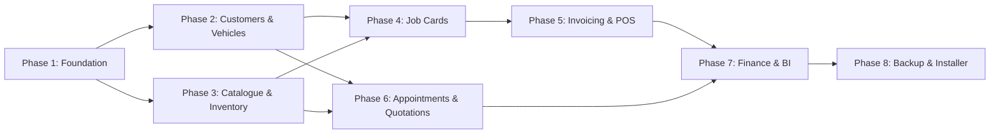

# Phase Plan

## Vehicle Service Center Management & Business Intelligence System

| Field            | Value                          |
| ---------------- | ------------------------------ |
| Version          | 0.1 – Draft                    |
| Status           | Awaiting Product Owner Review  |
| Last Updated     | 2026-11-13                     |

---

## Phase 1: Foundation

**Goal:** Project setup, build pipeline, authentication, business selection, permissions, settings, and audit log.

### Task 1.1 — Project Scaffolding
| Item | Detail |
|------|--------|
| **Work** | Initialize Electron + React + TypeScript project. Configure build tools (Vite or Webpack), TypeScript config, ESLint, Prettier. Set up folder structure per ARCHITECTURE.md. |
| **Essential for v1?** | Yes |
| **Acceptance Criteria** | App launches an empty Electron window. `npm run dev` starts hot-reload. `npm run build` produces a working bundle. TypeScript compiles without errors. |
| **Tests** | Build succeeds. Linting passes. |

### Task 1.2 — Database Infrastructure
| Item | Detail |
|------|--------|
| **Work** | Install `better-sqlite3`. Create `connection.ts` (open/close, WAL mode, `PRAGMA foreign_keys = ON`). Create `migrate.ts` (migration runner). Create the `migrations` table. Create `master.ts` for master registry operations. |
| **Essential for v1?** | Yes |
| **Acceptance Criteria** | Can open/close SQLite databases. Migration runner applies SQL files in order. Master registry DB is created on first launch. |
| **Tests** | Migration runner applies migrations idempotently. Migration order is correct. WAL mode is enabled. Foreign keys are enforced. |

### Task 1.3 — Master Registry & Business Management
| Item | Detail |
|------|--------|
| **Work** | Create `businesses` table in master.db. Service and IPC for: create business (provisions new DB with initial migration), list businesses, select business. |
| **Essential for v1?** | Yes |
| **Acceptance Criteria** | Can create a business; a new DB file appears. Can list businesses. Selecting a business opens its DB. |
| **Tests** | Business creation is idempotent (no duplicate names). DB file is created with correct schema. Listing returns only active businesses. |

### Task 1.4 — Initial Business Database Schema
| Item | Detail |
|------|--------|
| **Work** | Create migration `001_initial_schema.sql` with tables: `migrations`, `users`, `permissions`, `roles`, `role_permissions`, `user_roles`, `settings`, `audit_log`, `sequences`. Seed default permissions, roles, role_permissions, and default settings. |
| **Essential for v1?** | Yes |
| **Acceptance Criteria** | A new business DB has all Phase 1 tables. Default 7 roles exist with their default permissions. Default settings are seeded. |
| **Tests** | All tables exist with correct columns. Default roles and permissions are present. Foreign keys are valid. |

### Task 1.5 — User & Authentication Service
| Item | Detail |
|------|--------|
| **Work** | Install `argon2` (or `bcrypt`). Create `auth.service.ts`: register user (hash password), authenticate (verify hash), get user by ID. Create first owner user during business creation. IPC handlers for login/logout. Session management in main process. |
| **Essential for v1?** | Yes |
| **Acceptance Criteria** | Can create a user with hashed password. Can authenticate with correct password. Rejected with wrong password. Session stores user ID and permissions. Logout clears session. |
| **Tests** | Password is never stored in plaintext. Correct password passes. Wrong password fails. Session contains resolved permissions. Login is logged in audit log. Failed login is logged. |

### Task 1.6 — Permission Service
| Item | Detail |
|------|--------|
| **Work** | Create `permissions.service.ts`: resolve permissions for a user (union of all role permissions), `requirePermission()` guard, `requireModuleEnabled()` guard. Owner role protection logic. |
| **Essential for v1?** | Yes |
| **Acceptance Criteria** | Permission check passes for granted permissions and fails for missing ones. Feature toggle disables module access. Owner role always has settings access. |
| **Tests** | User with role A + role B gets union of permissions. Missing permission throws ForbiddenError. Disabled module throws ModuleDisabledError. Owner role cannot lose `settings:*`. At least one user must always hold the owner role. |

### Task 1.7 — Audit Log Service
| Item | Detail |
|------|--------|
| **Work** | Create `audit.service.ts`: log action with user, entity, old/new values. Query audit log with filters. |
| **Essential for v1?** | Yes |
| **Acceptance Criteria** | Actions are logged with correct details. Audit log is queryable by date, user, action, entity. Entries cannot be modified or deleted. |
| **Tests** | Log entry is created with all fields. UPDATE on audit_log fails. DELETE on audit_log fails. Query filters work correctly. |

### Task 1.8 — Settings Service
| Item | Detail |
|------|--------|
| **Work** | Create `settings.service.ts`: get setting (with default fallback), set setting (with audit log), get all settings by category, get feature toggles. |
| **Essential for v1?** | Yes |
| **Acceptance Criteria** | Can read settings with defaults. Can update settings. Changes are audit-logged. Feature toggles are readable. |
| **Tests** | Missing setting returns default. Updated setting returns new value. Audit log records old and new values. Feature toggle affects `requireModuleEnabled()`. |

### Task 1.9 — Shared Types & Validation
| Item | Detail |
|------|--------|
| **Work** | Define shared TypeScript types in `src/shared/types/`: User, Role, Permission, Setting, AuditLogEntry. Install Zod. Define validation schemas in `src/shared/validation/`. Define `MoneyAmount` type and validation. |
| **Essential for v1?** | Yes |
| **Acceptance Criteria** | All Phase 1 entities have TypeScript types and Zod validation schemas. MoneyAmount validates as integer. |
| **Tests** | Valid inputs pass validation. Invalid inputs (wrong types, missing required, float money) fail with descriptive errors. |

### Task 1.10 — Renderer: Business Selection & Login UI
| Item | Detail |
|------|--------|
| **Work** | Basic React setup with routing. Business selection screen (list businesses, create business form). Login screen (username/password). Main app shell with navigation (sidebar or top nav). Protected routes based on authentication. |
| **Essential for v1?** | Yes |
| **Acceptance Criteria** | User can see business list. Can create a business. Can log in. Sees the main app shell. Cannot access app routes without logging in. |
| **Tests** | UI renders without errors. Login with valid credentials navigates to app. Login with invalid credentials shows error. |

### Task 1.11 — Renderer: Settings UI (Partial)
| Item | Detail |
|------|--------|
| **Work** | Settings page with tabs: Business Profile (name, address, contact, logo), Users (list, create, edit, deactivate), Roles & Permissions (permission matrix grid), Feature Toggles (module on/off switches). |
| **Essential for v1?** | Yes |
| **Acceptance Criteria** | Can view and edit business profile. Can manage users (CRUD). Can view and edit role permissions via matrix. Can toggle modules on/off. All changes are saved and audit-logged. |
| **Tests** | Settings changes persist after reload. Permission matrix updates are reflected in permission checks. Feature toggle disables module UI. |

### Task 1.12 — Error Handling & Logging Infrastructure
| Item | Detail |
|------|--------|
| **Work** | Create typed error classes. Create logger utility. Set up application log file. Create error-handling wrapper for IPC handlers. |
| **Essential for v1?** | Yes |
| **Acceptance Criteria** | Errors are caught and logged. IPC errors return structured responses. Application log file is created and rotated. |
| **Tests** | Typed errors carry correct properties. IPC handler wrapper converts errors to responses. Logger writes to file. |

---

## Phase 2: Customers & Vehicles

**Goal:** Customer management, vehicle management, and history views.

### Task 2.1 — Database Migration: Customers & Vehicles
| Item | Detail |
|------|--------|
| **Work** | Migration `002_customers_vehicles.sql`: `customers`, `vehicle_categories`, `vehicles`, `service_reminders` tables plus indexes. Seed default vehicle categories. |
| **Essential for v1?** | Yes |
| **Acceptance Criteria** | All tables created with correct schema. Default vehicle categories seeded. Indexes exist. |
| **Tests** | Tables exist. FK constraints work. Soft delete works. |

### Task 2.2 — Customer Service & Repository
| Item | Detail |
|------|--------|
| **Work** | CRUD operations for customers. Search by name, phone, NIC. Duplicate detection (phone, NIC). Outstanding balance query. |
| **Essential for v1?** | Yes |
| **Acceptance Criteria** | Can create, read, update, deactivate customers. Search works. Duplicate warning on matching phone/NIC. |
| **Tests** | CRUD operations work. Deactivated customers excluded from default queries. Search returns correct results. Duplicate detection triggers on matching phone. Validation rejects invalid input. |

### Task 2.3 — Vehicle Service & Repository
| Item | Detail |
|------|--------|
| **Work** | CRUD for vehicles. Link to customer. Category-specific extra fields (JSON). Search by registration, chassis. |
| **Essential for v1?** | Yes |
| **Acceptance Criteria** | Can create vehicles linked to customers. Extra fields stored and retrieved. Search works. |
| **Tests** | Vehicle links to customer via FK. Extra fields persist correctly. Search by registration returns correct vehicle. Soft delete works. |

### Task 2.4 — Vehicle Categories Management
| Item | Detail |
|------|--------|
| **Work** | CRUD for vehicle categories in Settings. Extra fields schema definition. |
| **Essential for v1?** | Yes |
| **Acceptance Criteria** | Can add/edit/deactivate vehicle categories. Can define extra fields per category. |
| **Tests** | Category CRUD works. Deactivated categories not shown in dropdowns. |

### Task 2.5 — Service Reminders
| Item | Detail |
|------|--------|
| **Work** | CRUD for reminders. Query due reminders (by date and mileage). Mark as completed. |
| **Essential for v1?** | Yes |
| **Acceptance Criteria** | Can create date and mileage reminders. Can query upcoming due reminders. Can mark completed. |
| **Tests** | Date reminders due today/past are returned. Mileage reminders due (last mileage + threshold) are returned. Completed reminders excluded. |

### Task 2.6 — Renderer: Customer & Vehicle UI
| Item | Detail |
|------|--------|
| **Work** | Customer list page (with search). Customer detail page (profile, vehicles, history placeholder). Vehicle list/detail page. Customer/vehicle create and edit forms. |
| **Essential for v1?** | Yes |
| **Acceptance Criteria** | Full customer and vehicle CRUD from the UI. Search works. History tab exists (populated in later phases). |
| **Tests** | Forms validate input. Create/edit persists data. Search returns results. Permission checks work (view/create/edit/delete). |

---

## Phase 3: Service Catalogue & Inventory

**Goal:** Services catalogue, inventory items, suppliers, stock ledger, and purchases.

### Task 3.1 — Database Migration: Catalogue & Inventory
| Item | Detail |
|------|--------|
| **Work** | Migration `003_catalogue_inventory.sql`: `service_categories`, `services`, `service_vehicle_categories`, `inventory_categories`, `units_of_measure`, `inventory_items`, `suppliers`, `stock_movements`, `purchases`, `purchase_items`. Seed defaults. |
| **Essential for v1?** | Yes |
| **Acceptance Criteria** | All tables created. Default categories and units seeded. |
| **Tests** | Schema correct. FKs valid. Stock movement append-only constraint works. |

### Task 3.2 — Service Catalogue Service & Repository
| Item | Detail |
|------|--------|
| **Work** | CRUD for services and service categories. Link services to vehicle categories. |
| **Essential for v1?** | Yes |
| **Acceptance Criteria** | Can manage services with prices (integer), categories, vehicle-category applicability. |
| **Tests** | Price stored as integer. Service-vehicle-category links work. Soft delete works. |

### Task 3.3 — Inventory Item Service & Repository
| Item | Detail |
|------|--------|
| **Work** | CRUD for inventory items, categories, units. Stock level calculation from movement ledger. Low-stock alert query. |
| **Essential for v1?** | Yes |
| **Acceptance Criteria** | Can manage items. Stock level = SUM(movements). Low-stock items identified. |
| **Tests** | Stock level matches movement sum. Low-stock threshold triggers correctly. No `current_quantity` column anywhere. |

### Task 3.4 — Stock Movement Ledger
| Item | Detail |
|------|--------|
| **Work** | Create movement entries for each type. Negative stock prevention (if confirmed). Movement history query. |
| **Essential for v1?** | Yes |
| **Acceptance Criteria** | Movements are append-only. Each movement changes the calculated stock. History shows all movements for an item. |
| **Tests** | Cannot UPDATE or DELETE movements via service layer. Stock level is always SUM(quantity). Adjustment requires reason. |

### Task 3.5 — Supplier & Purchase Service
| Item | Detail |
|------|--------|
| **Work** | CRUD for suppliers. Create purchase with items. Purchase creates stock-in movements. |
| **Essential for v1?** | Yes |
| **Acceptance Criteria** | Can manage suppliers. Can record purchases. Stock increases on purchase. |
| **Tests** | Purchase creates correct stock movements. Total matches sum of items. FK to supplier works. |

### Task 3.6 — Renderer: Catalogue & Inventory UI
| Item | Detail |
|------|--------|
| **Work** | Service catalogue pages (list, create, edit). Inventory pages (items, categories, stock levels). Supplier pages. Purchase entry form. Stock adjustment form. |
| **Essential for v1?** | Yes |
| **Acceptance Criteria** | Full CRUD from UI. Stock levels displayed. Low-stock highlighted. |
| **Tests** | Forms validate. Prices displayed correctly from integers. Permission checks enforced. |

---

## Phase 4: Job Cards

**Goal:** Job card workflow from reception to delivery, technician assignment, parts usage.

### Task 4.1 — Database Migration: Job Cards
| Item | Detail |
|------|--------|
| **Work** | Migration `004_job_cards.sql`: `job_cards`, `job_card_services`, `job_card_parts`. Seed default statuses and priorities in settings. Add job_card sequence to sequences table. |
| **Essential for v1?** | Yes |
| **Acceptance Criteria** | Tables created. Default statuses configured. Sequence ready. |
| **Tests** | Schema correct. FKs valid. |

### Task 4.2 — Job Card Service
| Item | Detail |
|------|--------|
| **Work** | Create job card (with auto-number). Status transitions with validation. Assign technician. Add/remove services. Add parts (with stock movement). Update progress and findings. |
| **Essential for v1?** | Yes |
| **Acceptance Criteria** | Full job card lifecycle. Parts usage deducts stock. Status transitions are validated. |
| **Tests** | Job card number is sequential. Status can only move forward (no skipping). Parts create stock-out movements. Cannot assign inactive technician. Mileage recorded. |

### Task 4.3 — Job Card Status Workflow
| Item | Detail |
|------|--------|
| **Work** | Configurable statuses from settings. Workflow-critical statuses cannot be removed. Status transition rules. |
| **Essential for v1?** | Yes |
| **Acceptance Criteria** | Statuses are configurable. Critical statuses enforced. Invalid transitions rejected. |
| **Tests** | Cannot remove "Open" or "Delivered" status. Can rename statuses. Transition rules enforced. |

### Task 4.4 — Renderer: Job Card UI
| Item | Detail |
|------|--------|
| **Work** | Job card list (filterable by status, technician, date). Job card detail view (customer, vehicle, services, parts, findings, status, history). Create job card form. Technician assignment. |
| **Essential for v1?** | Yes |
| **Acceptance Criteria** | Full job card workflow from UI. Technician sees assigned jobs. Manager can assign. |
| **Tests** | Status transitions update UI. Parts usage shows stock impact. Permission checks for assign vs. update. |

---

## Phase 5: Invoicing, Payments & POS

**Goal:** Shared invoice engine, payments, POS sales, void and credit notes.

### Task 5.1 — Database Migration: Invoicing
| Item | Detail |
|------|--------|
| **Work** | Migration `005_invoicing.sql`: `invoices`, `invoice_items`, `payments`. Invoice and payment sequences. |
| **Essential for v1?** | Yes |
| **Acceptance Criteria** | Tables created. Sequences ready. |
| **Tests** | Schema correct. Invoice immutability constraints. |

### Task 5.2 — Invoice Service
| Item | Detail |
|------|--------|
| **Work** | Create invoice from job card or POS. Line items with prices, tax, discount. Total calculation (integer arithmetic). Invoice numbering. Invoice immutability enforcement. |
| **Essential for v1?** | Yes |
| **Acceptance Criteria** | Invoice created with correct totals. Numbers are sequential. Cannot edit after creation. |
| **Tests** | Total = Σ(line totals) + tax - discount + rounding. All amounts are integers. Cannot UPDATE invoice amounts. Number never reused. |

### Task 5.3 — Payment Service
| Item | Detail |
|------|--------|
| **Work** | Record payment against invoice. Update invoice status (Unpaid → Partial → Paid). Partial payment tracking. Payment is append-only. |
| **Essential for v1?** | Yes |
| **Acceptance Criteria** | Payments recorded. Invoice status auto-updates. Cannot overpay. Payments immutable. |
| **Tests** | Payment updates invoice paid_amount and due_amount. Status changes at correct thresholds. Cannot UPDATE or DELETE payment. Overpayment rejected. |

### Task 5.4 — Void & Credit Note
| Item | Detail |
|------|--------|
| **Work** | Void invoice flow. Credit note creation. Stock reversal on void. |
| **Essential for v1?** | Yes |
| **Acceptance Criteria** | Void marks invoice, reverses stock. Credit note links to original. |
| **Tests** | Voided invoice has status "Void". Stock movements reversed. Credit note has negative amounts. Cannot void already-void invoice. |

### Task 5.5 — Settings: Financial Options
| Item | Detail |
|------|--------|
| **Work** | Tax rate configuration. Payment method management. Rounding rules. |
| **Essential for v1?** | Yes |
| **Acceptance Criteria** | Tax rate applied to invoices. Payment methods configurable. Rounding works. |
| **Tests** | Tax calculation uses configured rate. Only active payment methods available. Rounding matches configured rule. |

### Task 5.6 — Renderer: Billing UI
| Item | Detail |
|------|--------|
| **Work** | Invoice view/print. Payment form. POS sale form. Void dialog. Customer billing history. |
| **Essential for v1?** | Yes |
| **Acceptance Criteria** | Can create invoices, record payments, make POS sales, void invoices from UI. |
| **Tests** | Amounts display correctly. Payment updates balance. Void requires confirmation and reason. |

---

## Phase 6: Appointments & Quotations

**Goal:** Appointment management, quotation lifecycle, conversions.

### Task 6.1 — Database Migration: Appointments & Quotations
| Item | Detail |
|------|--------|
| **Work** | Migration `006_appointments_quotations.sql`: `appointments`, `appointment_services`, `quotations`, `quotation_items`. Sequences. |
| **Essential for v1?** | Yes |
| **Acceptance Criteria** | Tables created. Sequences ready. |
| **Tests** | Schema correct. |

### Task 6.2 — Appointment Service
| Item | Detail |
|------|--------|
| **Work** | CRUD for appointments. Status management. Convert to job card. Walk-in registration. |
| **Essential for v1?** | Yes |
| **Acceptance Criteria** | Can create, update, cancel appointments. Can convert to job card. Walk-ins supported. |
| **Tests** | Conversion creates job card with correct data. Status transitions valid. Walk-in has `source = 'walk-in'`. |

### Task 6.3 — Quotation Service
| Item | Detail |
|------|--------|
| **Work** | CRUD for quotations. Status lifecycle (Draft → Sent → Approved/Rejected → Converted). Convert to job card or invoice. Optional approval flow. Expiry management. |
| **Essential for v1?** | Yes |
| **Acceptance Criteria** | Full quotation lifecycle. Conversion creates correct downstream records. |
| **Tests** | Totals calculated correctly (integers). Conversion links records. Expired quotations flagged. Approval optional based on setting. |

### Task 6.4 — Renderer: Appointment & Quotation UI
| Item | Detail |
|------|--------|
| **Work** | Appointment list/calendar view. Appointment create/edit form. Quotation list, detail, create/edit. Conversion buttons. |
| **Essential for v1?** | Yes |
| **Acceptance Criteria** | Full appointment and quotation workflow from UI. |
| **Tests** | Conversion updates status. Calendar shows correct day. Permission checks enforced. |

---

## Phase 7: Finance Summary & BI Dashboards

**Goal:** Finance records, daily sales summary, BI dashboards.

### Task 7.1 — Database Migration: Finance
| Item | Detail |
|------|--------|
| **Work** | Migration `007_finance.sql`: `expenses`, `employees` (if not already created). Seed expense categories in settings. |
| **Essential for v1?** | Yes |
| **Acceptance Criteria** | Tables created. Default categories seeded. |
| **Tests** | Schema correct. |

### Task 7.2 — Expense Service
| Item | Detail |
|------|--------|
| **Work** | CRUD for expenses. Category management. |
| **Essential for v1?** | Yes |
| **Acceptance Criteria** | Can record and manage expenses. Categories configurable. |
| **Tests** | Amounts are integers. Categories filter correctly. Soft delete works. |

### Task 7.3 — Employee Service
| Item | Detail |
|------|--------|
| **Work** | CRUD for employees. Link to user accounts. Performance query (jobs completed, revenue by period). |
| **Essential for v1?** | Yes |
| **Acceptance Criteria** | Can manage employees. Performance data calculated from job cards and invoices. |
| **Tests** | Employee-user link works. Performance numbers match actual job cards. |

### Task 7.4 — Daily Sales Summary
| Item | Detail |
|------|--------|
| **Work** | Query: total invoiced, total collected, breakdown by payment method for a given date range. |
| **Essential for v1?** | Yes |
| **Acceptance Criteria** | Summary matches actual invoices and payments. |
| **Tests** | Totals match sum of invoices/payments. Payment method breakdown is correct. Date filter works. |

### Task 7.5 — Profit Summary
| Item | Detail |
|------|--------|
| **Work** | Revenue (from invoices) minus cost of parts (from invoice_items.cost_price_amount) minus expenses. Gross vs. net distinction. |
| **Essential for v1?** | Yes |
| **Acceptance Criteria** | Profit calculation is accurate. Gross and net clearly distinguished. |
| **Tests** | Revenue = sum of paid invoices. Cost = sum of cost prices. Net = revenue - cost - expenses. |

### Task 7.6 — BI Dashboard Queries
| Item | Detail |
|------|--------|
| **Work** | Implement queries for confirmed BI reports (from Open Question 6). Filters by date range, category, employee. |
| **Essential for v1?** | Yes (scope depends on OQ6 answer) |
| **Acceptance Criteria** | Each dashboard shows correct data from real transactions. Filters work. |
| **Tests** | Dashboard numbers match raw data queries. Empty date ranges return zero, not errors. |

### Task 7.7 — Renderer: Finance & BI UI
| Item | Detail |
|------|--------|
| **Work** | Expense entry pages. Employee list and performance view. Daily sales summary page. BI dashboard pages with charts (Recharts or Chart.js). Filters. |
| **Essential for v1?** | Yes |
| **Acceptance Criteria** | All financial and BI views functional with real data. |
| **Tests** | Charts render without errors. Filters update data. Permission checks enforced. |

---

## Phase 8: Backup/Restore, Installer & Documentation

**Goal:** Backup/restore functionality, Windows installer, user documentation.

### Task 8.1 — Backup Service
| Item | Detail |
|------|--------|
| **Work** | Copy DB file to selected destination with timestamp. Validate backup file integrity. |
| **Essential for v1?** | Yes |
| **Acceptance Criteria** | Backup creates a valid copy. File naming includes business name and timestamp. |
| **Tests** | Backup file is a valid SQLite database. Can be opened and queried. |

### Task 8.2 — Restore Service
| Item | Detail |
|------|--------|
| **Work** | Validate backup file. Confirm with user. Replace current DB. Run migrations if needed. |
| **Essential for v1?** | Yes |
| **Acceptance Criteria** | Restore replaces data. Old DB backed up as .bak. Migrations applied if backup is older version. |
| **Tests** | Restore replaces data correctly. Old data is recoverable from .bak. Invalid files rejected. |

### Task 8.3 — Data Integrity Validation
| Item | Detail |
|------|--------|
| **Work** | Consistency checks: stock levels vs. movements, invoice totals vs. line items, FK integrity. Runnable from Settings. |
| **Essential for v1?** | Yes |
| **Acceptance Criteria** | Validation detects and reports inconsistencies without modifying data. |
| **Tests** | Intentionally corrupt data is detected. Clean data passes. |

### Task 8.4 — Document Printing
| Item | Detail |
|------|--------|
| **Work** | Print templates for invoices, receipts, job cards, quotations. Business header with logo. Configurable layout. |
| **Essential for v1?** | Yes (scope depends on OQ4) |
| **Acceptance Criteria** | Documents print with correct data and formatting. Business details and logo shown. |
| **Tests** | Template renders without errors. Data matches source records. |

### Task 8.5 — Windows Installer
| Item | Detail |
|------|--------|
| **Work** | Configure electron-builder for Windows. NSIS or MSI installer. Desktop shortcut. Auto-create data directory on first launch. |
| **Essential for v1?** | Yes |
| **Acceptance Criteria** | Installer runs on Windows 10+. App launches after install. Data directory created. Uninstaller available. |
| **Tests** | Clean install works. Upgrade install preserves data. Uninstall removes app but preserves data. |

### Task 8.6 — Export
| Item | Detail |
|------|--------|
| **Work** | Export data as CSV (customers, invoices, inventory, etc.). PDF export for reports. |
| **Essential for v1?** | Can wait (nice to have) |
| **Acceptance Criteria** | CSV exports contain correct data. PDF matches screen view. |
| **Tests** | CSV is valid and parseable. All records exported (not just first page). |

### Task 8.7 — Renderer: Backup/Restore UI
| Item | Detail |
|------|--------|
| **Work** | Backup button in Settings with folder picker. Restore button with file picker and confirmation. Integrity check button with results display. |
| **Essential for v1?** | Yes |
| **Acceptance Criteria** | Backup and restore accessible from Settings. Confirmation required for restore. |
| **Tests** | UI flow works end-to-end. Permission check (`backup:create`, `backup:restore`). |

### Task 8.8 — User Documentation
| Item | Detail |
|------|--------|
| **Work** | In-app help or a bundled PDF/HTML guide covering all modules, common workflows, and troubleshooting. |
| **Essential for v1?** | Can wait (nice to have for initial release; essential before wider distribution) |
| **Acceptance Criteria** | Documentation covers all v1 modules. Step-by-step for common workflows. |
| **Tests** | All documented features match actual app behavior. |

### Task 8.9 — Final Integration Testing & Polish
| Item | Detail |
|------|--------|
| **Work** | End-to-end testing of complete workflows. Performance testing. UI polish. Bug fixes. |
| **Essential for v1?** | Yes |
| **Acceptance Criteria** | All workflows work end-to-end. No critical bugs. Performance meets NF requirements. |
| **Tests** | E2E test suite passes. No crashes during normal workflows. App launches within 5 seconds. |

---

## Phase Dependency Diagram

> Phases 2 and 3 can be built in parallel after Phase 1. Phase 4 requires both. Phase 6 can start after Phases 2 and 3 but before Phase 5.

---

## Summary: Essential vs. Can Wait

| Phase | Task    | Essential for v1? |
|-------|---------|-------------------|
| 1     | All     | Yes               |
| 2     | All     | Yes               |
| 3     | All     | Yes               |
| 4     | All     | Yes               |
| 5     | All     | Yes               |
| 6     | All     | Yes               |
| 7     | All     | Yes               |
| 8     | 8.1–8.5, 8.7, 8.9 | Yes       |
| 8     | 8.6 (Export) | Can wait      |
| 8     | 8.8 (Docs)   | Can wait      |
